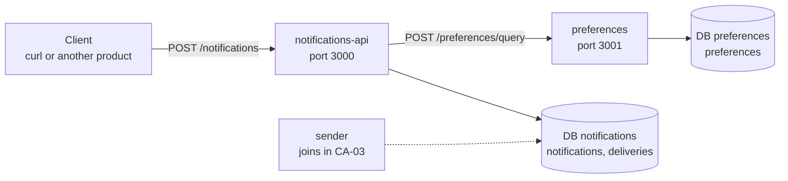

# Chaos Arena: CA-01 Spec

October 24, 2026 · Sharon Hen

## Status

Approved on November 2, 2026. This document gathers in one place the decisions from BE-05, BE-06 and HLD-03, and what was decided while planning CA-01. The decisions are collected in the last section.

At the start of CA-01b the document moves into the repo as `docs/spec.md`, and CLAUDE.md points to it. This way Claude Code works by your decisions and does not invent its own.

## What we build in CA-01

Two services and MongoDB, running locally without Docker. A request to send a notification to a list of users is checked against their preferences, and a delivery with the correct status is saved for each recipient.

**The product in short:** a notifications service. Another product sends a request: "send this message to these users". The service decides who to send to and saves the decision. In CA-03 it will also actually send, through a queue and a fake provider.

**In scope:** fan-out to up to 1,000 recipients, opt-out check, saving to Mongo, status endpoints, health, central error handling and request id. **Out of scope:** queue, sender and actual sending. Details are in the "Out of scope" section.

**Acceptance test:** CA-01 is done when all of these work.

- [ ] `POST /notifications` to three users (one opted out, one nonexistent) returns `202`.
- [ ] `GET /notifications/:id` returns `total: 3` and `counts` of `queued: 1, skipped: 2`.
- [ ] `GET /notifications/:id/deliveries` shows the status and the reason for each user.
- [ ] When preferences is down, `POST /notifications` returns `503`, and nothing is saved.
- [ ] `GET /health` responds in both services.

## Terms

| Term | Meaning |
| --- | --- |
| notification | One request to send a message to a list of users. One document in `notifications`. |
| delivery | The copy of a notification for one recipient, with its own status. One document in `deliveries`. |
| fan-out | Turning one notification into many deliveries, one per recipient. |
| opt-out | A user who asked not to receive notifications (`optedOut: true`). |
| `queued` | The delivery passed the checks and is waiting to be sent. In CA-01 it stays this way, because there is no sender yet. |
| `skipped` | We decided not to send. A final state, with a `reason`. |
| existing user | A user who has a document in preferences. |

## Services and databases



Each service accesses only its own database.

notifications-api does not read the preferences database. It asks the service over HTTP. The sender will join the notifications-api database in CA-03, because both are the same domain. On your machine, both databases sit on the same Mongo server.

## Data model

Two databases on the same Mongo server, and each service connects only to its own.

### database `notifications` (owner: notifications-api)

**collection `notifications`:** one document per send request. It has no stored `status` field, because the status is computed at read time from the deliveries.

| Field | Type | Notes |
| --- | --- | --- |
| `_id` | ObjectId | Generated automatically |
| `title` | string | 1 to 200 characters |
| `body` | string | 1 to 2,000 characters |
| `total` | number | Number of recipients after removing duplicates |
| `createdAt` | Date |  |

**collection `deliveries`:** one document per recipient of each notification.

| Field | Type | Notes |
| --- | --- | --- |
| `_id` | ObjectId | Also used as the pagination cursor |
| `notificationId` | ObjectId | The notification this document belongs to |
| `userId` | string |  |
| `status` | string | In CA-01: `queued` or `skipped`. CA-03 adds `sent`, `failed`, `cancelled` |
| `reason` | string | Only when `status` is `skipped`: `opted_out` or `unknown_user` |
| `createdAt` | Date |  |
| `updatedAt` | Date | Will change when the sender updates a status (CA-03) |

**indexes on `deliveries`:**

| Index | Why |
| --- | --- |
| `{ notificationId: 1, userId: 1 }`, unique | The same user will not get two deliveries in the same notification. If the fan-out runs twice, Mongo stops the duplicate |
| `{ notificationId: 1, _id: 1 }` | The list of deliveries of a notification, sorted by `_id` for the cursor, and also the `counts` calculation |

### database `preferences` (owner: preferences)

**collection `preferences`:** one document per user. An existing document means the user exists. Users are created by a seed script.

| Field | Type | Notes |
| --- | --- | --- |
| `_id` | string | The `userId` itself, so no additional index is needed |
| `optedOut` | boolean | Default `false` |
| `updatedAt` | Date |  |

Quiet hours and channels will be added to the same document later.

## notifications-api endpoints (port 3000)

No version in the URL, because there are no external clients.

### `POST /notifications`

Creates a notification and performs the fan-out. Returns `202`, because the sending itself has not happened yet.

```json
{ "userIds": ["u1", "u2", "u3"], "title": "Your order has shipped", "body": "It will arrive on Thursday" }
```

- `userIds`: 1 to 1,000 non-empty strings (one constant in the code, `MAX_RECIPIENTS_PER_REQUEST`). The cap is checked before removing duplicates, and duplicates are removed silently.
- A client that wants to send to more than 1,000 recipients sends several requests, and each one is a separate notification. The cap is removed in CA-03.
- Response: `202`, with the header `Location: /notifications/<id>`, and a body identical to the `GET /notifications/:id` response.
- Errors: `400 VALIDATION_ERROR` (including more than 1,000 recipients), `413 PAYLOAD_TOO_LARGE`, `503 PREFERENCES_UNAVAILABLE`.

### `GET /notifications/:id`

```json
{ "id": "6718...", "title": "...", "body": "...", "status": "processing", "total": 3, "counts": { "queued": 1, "skipped": 2 }, "createdAt": "2026-10-24T15:00:00.000Z" }
```

- `counts` always contains all existing statuses, even with 0, so the response shape stays fixed.
- Errors: `404 NOT_FOUND`, also when the id is not a valid ObjectId.

### `GET /notifications/:id/deliveries?limit=20&cursor=...`

```json
{ "data": [ { "id": "6718...", "userId": "u2", "status": "skipped", "reason": "opted_out", "createdAt": "..." } ], "nextCursor": "NjcxOC4uLg==" }
```

- Sorted by `_id` in ascending order, meaning creation order.
- `limit`: default 20, maximum 100. `cursor`: an opaque base64 string of the last `_id` on the page. On the last page `nextCursor` is `null`.
- Errors: `404 NOT_FOUND` when the notification does not exist, `400 VALIDATION_ERROR` when `limit` or `cursor` is invalid.

### `GET /health`

`200` with `{ "status": "ok" }` when Mongo answers a ping, otherwise `503`.

## preferences endpoints (port 3001)

The service returns data and does not decide. The "send or not" decision is made by notifications-api.

### `POST /preferences/query`

Returns the preferences of a list of users in one call. This is the endpoint the fan-out uses. `POST` and not `GET`, because 1,000 ids do not fit comfortably in a URL.

```json
{ "userIds": ["u1", "u2", "u3"] }
```

```json
{ "data": [ { "userId": "u1", "optedOut": false }, { "userId": "u2", "optedOut": true } ] }
```

- A user who does not exist simply does not appear in the response. In the example, `u3` is missing.
- Errors: `400 VALIDATION_ERROR`.

### `GET /users/:id/preferences`

- Response: `200` with `{ "userId", "optedOut", "updatedAt" }`.
- Errors: `404 NOT_FOUND`.

### `PATCH /users/:id/preferences`

- body: `{ "optedOut": true }`. It sets a value and does not change it relatively, so it is idempotent.
- Response: `200` with the updated document.
- Errors: `404 NOT_FOUND` when the user does not exist (PATCH does not create users), `400 VALIDATION_ERROR`.

### `GET /health`

Same as in notifications-api.

## The `POST /notifications` flow

Everything happens inside the request, and `202` returns only at the end. The order is built so that a preferences failure leaves nothing in the DB.

1. **Validation:** zod checks the body. An error returns `400`, and nothing is saved.
2. **Duplicate removal** from `userIds`. `total` is the number of unique users.
3. **One call to preferences:** `POST /preferences/query` with the whole list. When the connection fails or preferences returns `5xx`, `503` is returned, and nothing is saved.
4. **A decision for each user, in memory,** according to "Status rules".
5. **Saving the notification** in `notifications`.
6. **Saving all deliveries** in one `insertMany`.
7. **Response:** `202` with `Location`.

**No timeout in step 3, on purpose:** "slow preferences" is a fault in the CA-05 catalog. First we experience it and diagnose it, and only in stage 6 of the plan (CA-16) do we add a timeout and a circuit breaker and measure before and after. A real system would add a timeout from day one.

**Preparing for CA-03:** steps 3 to 6 sit in a separate function in the service. In CA-01 the service calls it directly. In CA-03 the call can be replaced by enqueuing, without touching the controller.

## Status rules

**delivery:** the first matching rule decides.

1. The user did not appear in the preferences response: `skipped`, with `reason: 'unknown_user'`.
2. `optedOut: true`: `skipped`, with `reason: 'opted_out'`.
3. Everything else: `queued`.

**notification:** computed on every read, and not stored.

- `counts`: a count of deliveries by `status`, with aggregation (`$match` by `notificationId`, followed by `$group` by `status`).
- `processing`: at least one delivery is still `queued`, or the sum of counts is less than `total`.
- `completed`: all deliveries are in a final state. In CA-01 this happens only when all are `skipped`.
- `cancelled`: will be added in CA-03.

The fixed rule: after the fan-out has finished, the sum of counts equals `total`.

## Errors, request id and configuration

**Uniform error format** in both services, per the decision from BE-06:

```json
{ "error": { "code": "VALIDATION_ERROR", "message": "...", "requestId": "...", "details": [] } }
```

| Status | Code | When |
| --- | --- | --- |
| 400 | `VALIDATION_ERROR` | Invalid body, query or JSON, including more than 1,000 recipients. `details` lists the fields |
| 404 | `NOT_FOUND` | The resource in the URL does not exist, or the route does not exist |
| 413 | `PAYLOAD_TOO_LARGE` | The body exceeds the `express.json()` limit. The error handler detects `type: 'entity.too.large'` and translates it |
| 503 | `PREFERENCES_UNAVAILABLE` | notifications-api did not receive a valid response from preferences |
| 500 | `INTERNAL_ERROR` | Everything else. A generic message, with full details in the log with the request id |

**Request id:** arrives in the `x-request-id` header. When it is missing or invalid (`/^[\w-]{1,64}$/`), a new id is generated. The id is returned in a response header.

**Middleware order:** `requestId → logger → express.json() → routes → 404 → errorHandler`.

**Environment configuration:** checked at service startup (fail fast), with a `.env.example` file in each service.

| Service | Variable | Local value |
| --- | --- | --- |
| notifications-api | `PORT` | `3000` |
| notifications-api | `MONGO_URL` | `mongodb://localhost:27017/notifications` |
| notifications-api | `PREFERENCES_URL` | `http://localhost:3001` |
| preferences | `PORT` | `3001` |
| preferences | `MONGO_URL` | `mongodb://localhost:27017/preferences` |

## Out of scope and known limitations

| What | When |
| --- | --- |
| Queue, sender, fake-provider and actual sending | CA-03 |
| `Idempotency-Key` on `POST /notifications` | CA-03 |
| Cancelling a notification | CA-03 |
| Rate limiting, quiet hours, priority | CA-03, all three together |
| `userIds` above 1,000, up to a 10MB body (a few hundred thousand recipients), with `pending` and a fan-out queue separate from the send queue | CA-03 |
| `GET /deliveries?userId=` | CA-03 or later |
| Docker, pino logs, passing the request id between services | CA-02 |
| Timeout and circuit breaker on the preferences call | Stage 6 (CA-16) |
| Channels (email or push) | Not decided |
| Auth between services | Not in the core |
| `audience`: a filter instead of a list, for larger audiences | Option to consider |

**Known limitations** (go into decisions.md):

- **Double write:** saving the notification and the `insertMany` are two separate operations. A crash between them leaves a notification with no deliveries, which stays `processing` forever. This is the same family as the dual write problem from CA-03.
- **No timeout toward preferences:** when preferences is slow, `POST /notifications` hangs with it. This is intentional, see "The `POST /notifications` flow".
- **A typo in a single recipient's `userId`** does not return an error right away. The client sees `skipped` with `unknown_user` only when asking for the status.
- **Opt-out blocks all notifications:** CA-01 does not distinguish between notification types, so a user who opted out will not receive a verification code either. In a real product, opt-out applies only to marketing messages. Solved in CA-03, when priority is added.
- **Cap of 1,000 recipients per request in CA-01:** above 1,000 the request is rejected with `400`, and a body over 100KB is rejected with `413`. A client that wants more sends several requests, and each one is a separate notification. In CA-03 the cap is removed, leaving a 10MB body limit, meaning a few hundred thousand recipients per request. Such a limit is normal: Firebase also limits a call to 500 devices.

## Decisions

Approved on November 2, 2026. Every decision also goes into decisions.md in the repo.

- [x] **CA-01 scope:** as in the sections "What we build" and "Out of scope".
- [x] **Fan-out without a queue:** inside the request, and `202` only at the end. preferences is asked before any write.
- [x] **`counts`:** aggregation at read time, and the notification's `status` is computed and not stored.
- [x] **Unknown user:** `skipped` with `unknown_user`, and the whole request continues. An existing user means a user with a document in preferences.
- [x] **Duplicates in `userIds`:** removed silently, and `total` counts unique users. The cap is checked before removal.
- [x] **Invalid id in the URL:** returns `404`, not `400`.
- [x] **The name:** `delivery`, the common term in notification systems.
- [x] **More than 1,000 recipients:** in CA-01 `400`, and `413` for an oversized body. In CA-03 the cap is removed, leaving a body of up to 10MB, with `pending` and a fan-out queue.
- [x] **Mongo without Docker:** MongoDB Community installed locally.
- [x] **Repo structure:** one repo, with `services/notifications-api` and `services/preferences`, each service with its own `package.json`. At the root: shared tsconfig and ESLint, CLAUDE.md, decisions.md and `docs/spec.md`. No shared code package. The small duplication (AppError, request id) is documented.

**Already decided in CA-01a:** no version in the URL. One database per domain: `notifications` for notifications-api (and later for the sender too), and `preferences` for the preferences service. preferences is thin on purpose, and the trade-off is documented.

**Option to consider: `audience`.** A filter instead of a list, for example "everyone who has not opted out". The fan-out finds the users itself in preferences, in chunks of 1,000, so there is no body size limit. This is the way to reach millions of recipients, and the rest of the system (the queues, the statuses and the workers) stays as it is.